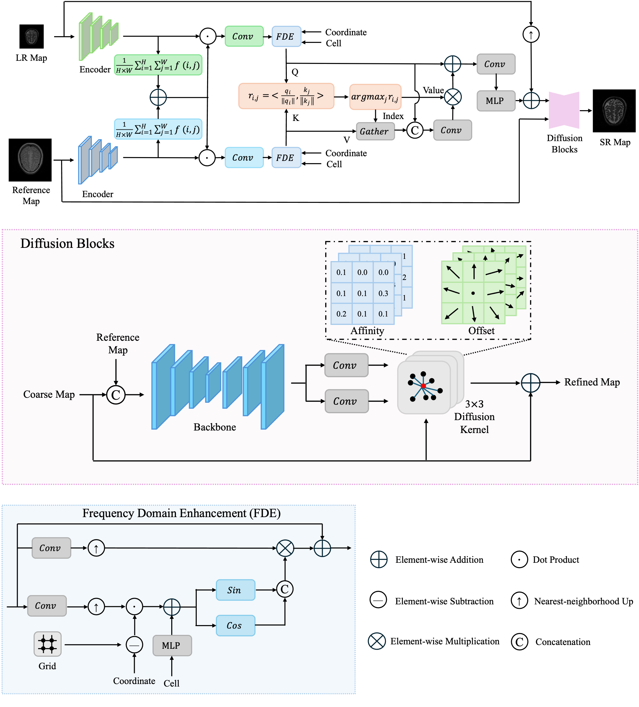

# Learning Dynamic Affinity Diffusion for Multi-Contrast MRI Super-Resolution via Implicit Neural Representations

<div align="center">

**Huajie Wen, Lixin Liang, Rashid Khan, Inayatul Haq, Kai Chen, Lin Lin, YongSheng Liang, and Bingding Huang**

*NeuroImage, 2026*

[**[Paper]**](https://doi.org/10.1016/j.neuroimage.2026.122324)

</div>

## Introduction

Magnetic resonance imaging (MRI) super-resolution (SR) focuses on reconstructing high-quality, high-resolution target images from sparsely acquired signals while enhancing reconstruction performance through guidance from a reference image. In clinical practice, MRI SR contributes to reduced scan durations and alleviates patient discomfort, as well as motion artifacts associated with extended immobility. Existing SR approaches, however, exhibit insufficient interaction with texture features from the reference image, which results in pronounced inaccuracies at image edges. In addition, these methods often neglect the issue of noise amplification introduced during the SR process. To overcome these limitations, an implicit dynamic spatial propagation network (IDSPN) is introduced, integrating an implicit neural network with dynamic spatial propagation. Initially, residual dense blocks and residual channel attention networks are employed to extract features from the low-resolution input and reference images, respectively. Subsequently, a texture transformer performs feature alignment between the input and reference images and transfers texture information from the reference image to the low-resolution input, followed by upsampling through an implicit neural network. A backbone network then estimates affinity and propagation offsets, enabling refinement via multi-stage iterative diffusion. The proposed approach is evaluated on three publicly available datasets, with experimental findings demonstrating state-of-the-art performance and indicating its potential for clinical application.

## Model Architecture

The overall architecture of the proposed IDSPN is shown below. It integrates multi-contrast feature extraction and alignment, implicit neural representation-based upsampling, and dynamic affinity diffusion for iterative refinement.



*Overview of the proposed implicit dynamic spatial propagation network.*

## Citation

If you find this work useful in your research, please consider citing:

```bibtex
@article{wen2026learning,
  title   = {Learning Dynamic Affinity Diffusion for Multi-Contrast {MRI} Super-Resolution via Implicit Neural Representations},
  author  = {Wen, Huajie and Liang, Lixin and Khan, Rashid and Haq, Inayatul and Chen, Kai and Lin, Lin and Liang, YongSheng and Huang, Bingding},
  journal = {NeuroImage},
  year    = {2026},
  doi     = {10.1016/j.neuroimage.2026.122324}
}
```
